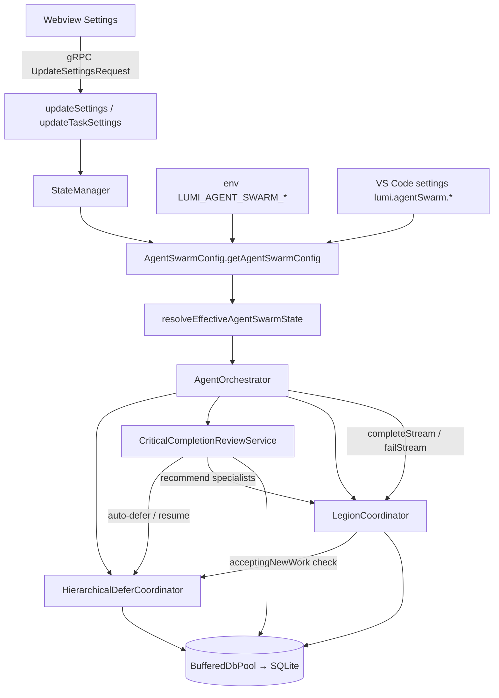
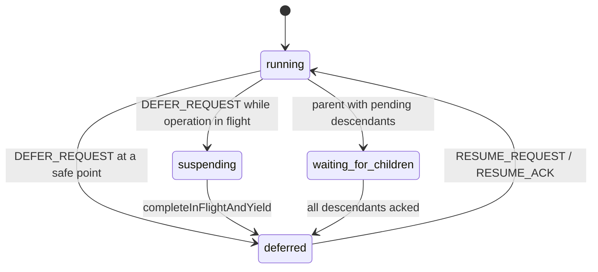
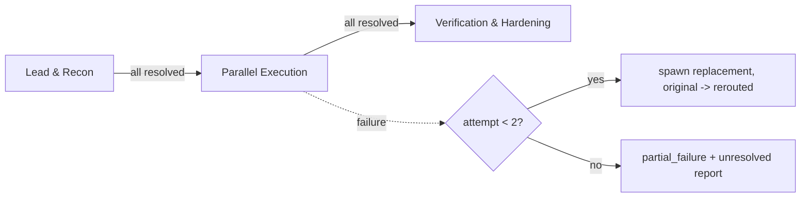

# How It Works — Inner Workings, and Why This Is Possible

## 1. Why this is possible at all

The hard-sounding parts ("freeze a whole agent hierarchy and resume it", "spawn the right specialist") are possible because the host already provides five primitives. The feature is a **protocol layered over them**, not a new runtime.

| Existing primitive                                                  | What it gives us                                               | Used for                                                                       |
| ------------------------------------------------------------------- | -------------------------------------------------------------- | ------------------------------------------------------------------------------ |
| **Streams** (`agent_streams`, `parentId`)                           | Independent execution identities with tree structure           | Parent/child separation; hierarchy walks                                       |
| **Durable key/value memory** (`agent_memory`, PK `(streamId, key)`) | A per-stream durable scratchpad                                | Checkpoints, control inboxes, roadmaps, manifests, reservations                |
| **`BufferedDbPool`**                                                | Batched, ordered, SQLite-backed writes with per-agent overlays | Persistence with no new infra; FK-safe flush                                   |
| **Cooperative turn/tool structure**                                 | Natural pause points between turns and tool calls              | `before_turn` / `safe_boundary` yield                                          |
| **Task rows** (`agent_tasks`) with JSON `metadata`                  | Status + free-form annotations                                 | Marking tasks "deferred" _without_ changing status; Legion specialist metadata |

Three facts make suspension safe:

1. **Suspension is observable state, not a process signal.** A stream "being deferred" is a durable record (`defer_agent_status`) plus a checkpoint. Nothing is killed.
2. **Completed work is receipted.** `completedToolReceipts` in the checkpoint record operation ids that already finished, so resume never replays side-effecting tools.
3. **The barrier is computed from durable state.** Parents don't wait on callbacks; they re-derive "is every descendant deferred?" from the stored statuses whenever any child reports.

And one fact makes the Legion cheap: **classification is deterministic scoring over text and file paths**, so choosing specialists needs no extra model call — spawning is just inserting rows.

## 2. Component map

## 3. Hierarchical Defer & Resume

### 3.1 Per-stream state machine

`acceptingNewWork` is `false` in `suspending`, `waiting_for_children` and `deferred`. `Orchestrator.createTask`, `spawnChildStream`, `spawnTeammateTask` and `LegionCoordinator.formAndSpawnLegion` reject new work in those states.

### 3.2 `deferAgent(streamId)` step by step

1. Resolve effective feature state; if Defer is off and not `forceEnable`, return `deferred:false` ("disabled").
2. Idempotency: already `deferred` at an equal-or-newer sequence → return the existing checkpoint and last `DEFER_ACK`.
3. Append `DEFER_REQUEST` (de-duplicated by `messageId`; inbox bounded to 200 messages).
4. If an in-flight operation is `running` and we are **not** (`immediate` ∧ interruptible ∧ idempotent) → write status `suspending`, return `deferred:false` with the reason. **Nothing is aborted.**
5. Otherwise finalize: mark active tasks deferred (metadata `deferred_state`, `deferred_checkpoint_id`; status unchanged; lease record `task_deferred_lease:<taskId>` so stalled-task detection ignores them), snapshot reservations, write `defer_checkpoint:<id>` + `defer_latest_checkpoint`, append `DEFER_ACK` to own and parent inbox, write status `deferred`.

### 3.3 `deferPipeline(rootStreamId)` and the barrier

1. Collect the hierarchy (BFS over `parentId`).
2. Root → `waiting_for_children` (or `suspending` if no descendants), `acceptingNewWork=false`.
3. Defer descendants **bottom-up**: a node whose own children are still pending becomes `waiting_for_children`; others call `deferAgent`.
4. `evaluateAndPersistPipelineState`: if nothing is pending, defer the root with the rolling roadmap → phase `suspended`; else phase `waiting_for_children`. The parent is **never** reported suspended while a descendant is still executing.

When a slow child later finishes its tool, `completeInFlightAndYield` finalizes it (recording the receipt) and calls `reconcilePipelineBarrier(parent, pipelineId)`:

- Takes a **per-pipeline lock** so concurrent siblings don't clobber each other.
- **Walks the whole `parentId` chain** to the stream whose `deferred_pipeline_status` matches the `pipelineId` (multi-level trees: the immediate parent often doesn't own it — PM-006).
- Re-evaluates bottom-up so intermediate nodes waiting on grandchildren can now defer, then re-evaluates the root.

`failStream`/`completeStream` also call `reconcileAfterStreamFailure` so a crashed or finished child can't deadlock a waiting parent.

### 3.4 Resume

`resumePipeline` resumes root and every active descendant **independently** (`resumeAgent`): restores deferred tasks to their `priorStatus`, refreshes heartbeats, emits `RESUME_REQUEST`/`RESUME_ACK`, sets `running` + `acceptingNewWork=true`; then restores the roadmap (`synchronizationStatus: "resumed"`). Resume of an already-running stream is an idempotent no-op ACK.

## 4. Critical Completion Review

Flow of `runReview(input)`:

1. Resolve state (precedence includes per-agent, per-task, manual invocation). **Disabled → immediate `ACCEPT`, `executed:false`** (zero work).
2. Bound check against persisted `critical_review_cycle:<completionEventId>`: no second initial review; at most 1 corrective pass.
3. If `autoDeferOnCompletionReview ∧ hierarchicalDeferEnabled`: `deferPipeline` while reviewing.
4. Classify findings (explicit findings, or derived from audit violations). Hypothetical/unverified "defects" are **downgraded** to `unverified_assumption`.
5. Decide:

| Condition                                                   | Decision                                     |
| ----------------------------------------------------------- | -------------------------------------------- |
| blocking capability unavailable ∧ (defects ∨ material risk) | `ESCALATE`                                   |
| confirmed defects, initial pass                             | `REMEDIATE` (+ prioritized corrective tasks) |
| confirmed defects, already corrective                       | `ESCALATE` (stop looping)                    |
| only risks/assumptions                                      | `ACCEPT_WITH_DISCLOSED_LIMITATIONS`          |
| otherwise                                                   | `ACCEPT`                                     |

6. Merge corrective tasks into the **existing** roadmap (no unbounded task chains); annotate each with a recommended specialist from the Legion.
7. If the pipeline was deferred for this review and the decision isn't `ESCALATE` → `resumePipeline`.
8. Persist cycle state + `last_critical_completion_review`.

**Integration:** `runCompletionGateFlow` and `AttemptCompletionHandler.execute` call `evaluateOptionalCriticalCompletionReview`; `REMEDIATE`/`ESCALATE` block completion and return the coordinator report.

## 5. The Legion

### 5.1 Classification (`classifyTaskForLegion`) — deterministic, no model call

1. Combine parent focus + task text; extract referenced files (`src|webview-ui|proto|scripts|cli|packages/...`) plus explicit `targetFiles`.
2. Infer primary intent by keyword counts (`CREATE`, `FIX`, `REFACTOR`, `INVESTIGATE`, `TEST`, `CONFIGURE`, `DELETE`, else `GENERAL`).
3. Score each archetype: weighted keyword groups (diminishing returns for repeats: `weight × (1 + min(3, hits−1) × 0.35)`), **+3.5 per matching target file**, intent-alignment bonus (+2.0/+2.5), **+6.0** if the caller marked the role preferred. Excluded roles are skipped. Zero-signal prompts fall back to the Implementer.
4. Complexity `= clamp(1 + activeDomains×1.3 + min(3, len/250) + min(3, files×0.6), 1, 10)`.
5. Strategy (when `adaptive`): `<3.2` → `tactical_strike`; `≥7.2` → `full_legion`; intent `TEST`/`FIX` → `verification_heavy`; else `balanced_squad`. Roster size follows the strategy (1 / 2–3 / 2–4 / ≥3, capped by `maxSpecialists`, hard cap 8). Multi-specialist formations pull in a verifier.
6. Partition target files across the roster so parallel workers never share a file.

### 5.2 Formation (`formAndSpawnLegion`)

Checks: Legion enabled (or `forceEnable`), parent exists, parent `acceptingNewWork`. For each roster member: insert child `agent_streams` row (**direct write**, ADR-0010), write `legion_specialist_profile`, insert a `pending` `agent_tasks` row with Legion metadata (`legion_formation_id`, `legion_specialist_role`, `legion_codename`, `legion_stage`, `assigned_files` …), reserve its files **only if no other _active_ stream holds them**. Then persist the manifest and update the parent roadmap.

### 5.3 Stage gating, failover, synthesis

- `evaluateStageProgression` computes per-stage status (`empty`, `blocked_by_prior_stage`, `ready`, `in_progress`, `completed`, `failed`) and the set of streams that may run now. `rerouted` counts as resolved; a failed, un-rerouted member **fails** its stage and blocks later ones.
- When a lead stage completes, its summaries are written to each newly unblocked member as `legion_stage_handoff_context`.
- `settleSpecialistStream` (called automatically from `completeStream`/`failStream`) = reconcile → bounded failover (only if Legion is enabled for the parent) → synthesize a report when the formation finishes or is stuck. All manifest read-modify-write cycles run under a **per-formation lock**; terminal member states are final (idempotent).
- Synthesis writes `last_legion_synthesis_report` (completed deliverables, failover log, unresolved failures, outstanding streams) and updates the roadmap's completed/blockers/next-actions.

### 5.4 Specialist Agent Host & Sandboxed Execution (`LegionAgentHost`, `LegionToolAdapter`, `Task.ts`)

With [ADR-0012](../adr/ADR-0012-automatic-legion-default.md), Legion executes automatically during act-mode tasks when native tool support is active:

1. **Eligibility & Delegation Policy (`delegationPolicy.ts`):** Evaluates whether the user prohibited delegation (`explicitlyProhibitsDelegation`), whether plan mode is active, or if multimodal attachments are present. If permitted, `Task.ts` dispatches `maybeRunAutomaticLegion`.
2. **Autonomous Tool Loop (`LegionAgentHost.ts`):** Dispatches specialist members through isolated API client conversations without polluting the parent transcript. Tracks `maxTokens` and `maxCost`, and aggregates incremental usage updates to the webview UI via `postStateToWebview()`. Heuristic token estimators step in if providers omit usage metadata. Transport decoding errors are caught and circuit-broken with `safeToRetry: false` ([ADR-0014](../adr/ADR-0014-tool-argument-stream-deduplication-and-self-healing-parser.md)).
3. **Sandboxed Tool Adapter (`LegionToolAdapter.ts`):**
   - Each specialist operates under an isolated `TaskState` with `executionOwner = legion:<streamId>`.
   - Approval callbacks, user permissions, and universal execution guards are inherited from the parent.
   - Command lifecycle tracking: captures spawned processes, settles completed terminal states across `{ status, command?.status, action?.status }`, and handles command abortion cleanly via `AbortSignal.any`.
   - File edit revisions are bubbled up to parent task state (`base.taskState.workspaceRevision += revisions`) so parent environment refreshes reflect all specialist file edits.
4. **Context Handoff Injection (`withLegionContext`):** When specialist pipelines complete, an evidence-rich `<specialist_handoff status="...">` block is injected into a copy of the root user objective turn in `apiConversationHistory`, allowing the parent task to review and build upon specialist findings without losing track of user follow-up turns.
5. **Steering Cancellation (`shouldAcceptSteeringInterrupt`):** Evaluates `this.activeLegionController` so that user chat messages during in-flight specialist runs abort the specialist pipeline immediately.

### 5.5 Orchestrator Conductor, Explicit Tool Dispatch & Streaming Cards (`engage_swarm`, `joy_zoning.ts`, `LegionPipelineRunner.ts`)

With [ADR-0013](../adr/ADR-0013-orchestrator-conductor-tool-and-streaming-progress.md), the parent model operates as the **Orchestrator Conductor**:

1. **System Prompt Role & Mode Integration (`joy_zoning.ts`, `capabilities.ts`, `act_vs_plan_mode.ts`):**
   - Whenever Swarm or Legion is enabled, `# 🐝 AGENT SWARM & THE LEGION — Orchestrator Conductor` is injected into `joy_zoning.ts`.
   - In **Plan Mode**: The conductor maps milestone steps to specialist archetypes (`legion_architect`, `legion_implementer`, `legion_verifier`, `legion_hardener`, `legion_ux_ergonomics`, `legion_researcher`, `legion_data_steward`).
   - In **Act Mode**: The conductor delegates sub-goals and test passes explicitly via `engage_swarm` or oversees stage progression.
2. **Explicit Conductor Tool (`engage_swarm`):**
   - Added to `DietCodeDefaultTool` and registered dynamically in `DietCodeToolSet.getEnabledTools` (omitted when `context.isTesting = true`).
   - Parameters:
     - `objective` (string, required): Specific task/test/investigation goal.
     - `strategy` (string, optional): One of `'adaptive' | 'tactical_strike' | 'balanced_squad' | 'full_legion' | 'verification_heavy'`.
     - `preferred_roles` (string or string[], optional): Specialist roles to prioritize.
     - `max_specialists` (integer, optional): Maximum specialists to spawn (clamped between 1 and 8).
   - Handled by `EngageSwarmHandler.ts`, which forms the Legion cohort, acquires necessary tokens, constructs isolated tool adapters, converts schemas to native provider formats, runs the pipeline with progress callbacks, and returns a `<specialist_handoff status="...">` block containing synthesized findings and untrusted receipt evidence.
3. **Autonomous Execution via Auto-Approval (`autoApprove.ts`):**
   - `DietCodeDefaultTool.ENGAGE_SWARM` is marked as auto-approved in `AutoApprove.shouldAutoApproveToolWithPath`, ensuring the parent conductor can dispatch teams autonomously without interrupting the user.
4. **Human-Centered Multi-Agent Streaming Cards (`formatLegionProgressMessage`):**
   - Real-time progress events are emitted by `LegionPipelineRunner` to `onProgress`:
     - `stage_started`: `### 🐝 The Legion — Stage X: <Name>\n> Commencing execution stage...`
     - `member_started`: `⚡ Specialist Active: **<Codename>** [<RoleTitle>]\n> *Objective: ...*`
     - `member_completed`: `✅ Specialist Complete: **<Codename>** (\`<role>\`) finished assigned work.`
     - `member_failed`: `⚠️ Specialist Alert: **<Codename>** (\`<role>\`) encountered an issue: ...`
     - `member_rerouted`: `🔄 Specialist Failover: **<Codename>** (\`<role>\`) failed; initiating ADR-0009 automatic failover replacement.`
     - `formation_completed`: `🎉 The Legion — Mission Accomplished\n> All specialist stages completed successfully...`
     - `formation_failed`: `⚠️ The Legion — Partial Completion\n> Specialist squad finished with partial findings...`
5. **Hardened Gating & Fallback Resilience:**
   - **Tactical Strikes & Test Projects:** If `appliedStrategy === "tactical_strike"` or the objective mentions test projects, swarm, or legion keywords, the strict `complexityScore >= 3.2` and minimum 2-member roster constraints are bypassed.
   - **Conversation History Fallback:** If `this.legionObjective` is not set on task entry, `maybeRunAutomaticLegion` extracts the user's initial objective from conversation history.
   - **File Attachment Preservation:** `Task.startTask` preserves `legionObjective` when files are attached (only multimodal images bypass automatic delegation).
   - **Fallback Completion Spec:** When specialist tool definitions are assembled, a fallback `attempt_completion` tool specification with a single `result: string` parameter is injected if absent.
   - **Budget Bounds & Categorized Failovers:** `LegionAgentHost` enforces `maxTokens` and `maxCost`. When a specialist fails, `safeToRetry` indicates whether failover rerouting (`orchestrator.failoverLegionSpecialist`) can proceed safely.

### 5.6 Tool Argument Stream Deduplication, Self-Healing Parser & Transport Circuit-Breaking (`StreamResponseHandler.ts`, `openai-codex.ts`, `LegionAgentHost.ts`)

With [ADR-0014](../adr/ADR-0014-tool-argument-stream-deduplication-and-self-healing-parser.md) and [PM-015](../postmortems/PM-015-tool-argument-snapshot-concatenation-and-stream-decoding-loop.md), LUMI introduces multi-tier streaming defense against provider payload anomalies and failover thrashing:

1. **Provider-Level Offset Tracking & Snapshot Slicing:**
   - In `openai-codex.ts`, `openai-native.ts`, and `responses_api_support.ts`, `toolCallDelta(callId, args, snapshot = false)` tracks accumulated character counts across streamed deltas.
   - When a model endpoint follows partial deltas with a full snapshot chunk (`response.output_item.done` or `response.function_call_arguments.done`), the snapshot is checked against `previous`: if it starts with the previously streamed text, only the unstreamed suffix is emitted; identical full snapshots emit an empty delta (`""`), preventing duplicate arguments at the source.
2. **Interleaved Tool Call Name and ID Tracking:**
   - Providers track active tool calls via bidirectional lookup maps (`toolCallIdByItemId`, `toolCallNameByItemId`, `toolCallNameByCallId`, `functionCallByItemId`).
   - When models emit interleaved chunks or drop explicit `name` fields on terminal events, the correct tool name and call ID are preserved rather than defaulting to empty or colliding with adjacent calls.
3. **State-Machine JSON Root Parser (`extractJsonRoots`):**
   - Implemented in `StreamResponseHandler.ts` to sequentially extract top-level JSON objects/arrays character by character.
   - Accurately tracks nested braces, brackets, quotes, escaped backslashes, and string values containing braces (e.g. `awk '{print $1}'` commands).
   - Returns `{ roots: ExtractedJsonRoot[], remainder: string }` with exact character start/end slices.
4. **Dual-Layer Self-Healing in `ToolUseHandler`:**
   - **Stream-Time:** `processToolUseDelta` detects prefix overlap or identical complete duplicate JSON roots (`fast-deep-equal`) and drops redundant deltas before accumulation.
   - **Terminal-Time:** `assertCompleteToolUses` intercepts `JSON.parse` failures. If `pending.input` contains multiple identical complete JSON roots with no unparsed remainder, it unifies the roots to `roots[0].value` and self-heals the tool input, allowing execution to proceed without failing.
5. **Diagnostic Typing (`ToolArgumentError`):**
   - Throws typed `ToolArgumentError` instances with explicit `kind` classifications (`incomplete`, `concatenation`, `syntax`, `invalid_format`), giving upstream callers transparent visibility into stream failures.
6. **Transport Circuit-Breaking in Specialist Execution:**
   - In `LegionAgentHost.execute`, caught errors are evaluated for transport decoding and syntax corruption (`isTransportError`).
   - If true, the specialist returns `status: "failed"` with `safeToRetry: false`.
   - Under [ADR-0009](../adr/ADR-0009-legion-lifecycle-dag-failover-terminal-states.md), `LegionCoordinator` respects `safeToRetry: false` and does **not** spawn a replacement specialist, stopping futile failover loops on transport corruption and preserving user budget.

### 5.7 Multi-Tier Terminal Heredoc Defense, Specialist Prompt Parity & Shell Integration Circuit-Breaking (`heredocPolicy.ts`, `LegionAgentHost.ts`, `ExecuteCommandToolHandler.ts`, `UniversalGuard.ts`, `VscodeTerminalProcess.ts`)

With [ADR-0015](../adr/ADR-0015-multi-tier-terminal-heredoc-defense-and-prompt-parity.md) and [PM-016](../postmortems/PM-016-terminal-heredoc-deadlock-and-prompt-parity.md), LUMI establishes defense-in-depth against terminal heredoc deadlocks and enforces specialist prompt parity:

1. **Specialist Prompt Parity (`LEGION_CORE_RULES` in `LegionAgentHost.ts`):**
   - Injects `LEGION_CORE_RULES` into every specialist system prompt upon execution.
   - Mandates `write_to_file` and `replace_in_file` for all file creations and modifications.
   - Strictly forbids multiline heredocs (`cat <<'EOF'`, `cat > file`, `tee`, `echo >`) and interactive stdin redirection, explaining that non-interactive terminal sessions deadlock on heredocs.
   - Restricts `execute_command` to non-interactive tasks (compilation, tests, linters, environment checks).

2. **Shell Token-Aware Policy Parser (`src/integrations/terminal/heredocPolicy.ts`):**
   - `findTopLevelHeredocs(command)`: Character-by-character scanner tracking single quotes, double quotes, escape characters, and arithmetic expansions (`$((...))` / `((...))`). Detects valid top-level heredocs while ignoring arithmetic shifts and string literals.
   - `detectHeredocFileRedirection(command)`: Detects file creation across all shell syntaxes (before/after delimiter, piped to `tee`/`sudo tee`/`cat`, tab-indented delimiters `<<-EOF`, quoted filenames). Returns `{ isHeredocFileWrite: true, targetFiles, reason }` directing the model to `write_to_file`.
   - `isMultilineHeredocCommand(command)`: Detects multiline commands with heredoc syntax (including interpreters or unclosed heredocs) that would deadlock interactive shell integration.

3. **Pre-Execution Interception & Approval Suppression (`ExecuteCommandToolHandler.ts`, `UniversalGuard.ts`, `FluidPolicyEngine.ts`, `ToolValidator.ts`):**
   - In `ExecuteCommandToolHandler`: detects heredoc file writes before UI approval prompting (`shouldAutoApprove || detectHeredocFileRedirection(command).isHeredocFileWrite`), preventing unnecessary interactive UI prompts. Intercepts the command before execution, emits `command_permission_denied`, and returns actionable guidance.
   - In `UniversalGuard` and `FluidPolicyEngine`: `guardPreExecution` and `validatePreExecution` reject heredoc file writes with structured policy errors.
   - In `ToolValidator`: `validateExecuteCommandParams` blocks heredoc file redirection.

4. **Shell Integration Circuit-Breaker (`VscodeTerminalProcess.ts` & `VscodeTerminalManager.ts`):**
   - In `VscodeTerminalProcess.run`: checks `isMultilineHeredocCommand(command)`. If interactive shell integration is active, safely switches to managed terminal fallback if available, or throws an explicit error refusing execution to prevent terminal deadlock.
   - In `VscodeTerminalManager.ts`: defers microtask dispatch for multiline heredoc commands so output and completion observers attach before execution.

### 5.8 Multi-Tier Terminal File Read Defense, Specialist Token Budget Starvation Resolution & Full Conductor-Specialist Prompt Parity (`terminalFileReadPolicy.ts`, `LegionAgentHost.ts`, `rules.ts`, `editing_files.ts`, `execute_command.ts`)

With [ADR-0016](../adr/ADR-0016-terminal-file-read-defense-budget-starvation-and-conductor-prompt-parity.md) and [PM-017](../postmortems/PM-017-terminal-file-dump-specialist-starvation-and-conductor-fallback.md), LUMI introduces defense against terminal file dumping and resolves multi-turn token starvation:

1. **Terminal File Read Policy Engine (`terminalFileReadPolicy.ts`):**
   - Intercepts file reads directed to terminal stdout (`cat`, `head`, `tail`, `more`, `less`, `tac`, `bat`, `nl`, `fold`, `pr`, `view`, `pg`, `most`).
   - Differentiates unpiped/unredirected file dumps from stream processing pipelines (`cat file | grep ...`, `cat file | jq ...`) and output redirection.
   - Detects interactive stdin deadlock traps (`cat > file` with no input).
   - Whitelists safe OS/kernel environment probes (`/proc/*`, `/sys/*`, `/etc/os-release`, etc.) and non-blocking streaming (`tail -f`).
2. **Specialist Token Budget Decoupling (`LegionAgentHost.ts`):**
   - Replaced arbitrary 100,000 token default with explicit parent task bounds: token limits are only enforced when `options.maxTokens !== undefined`.
   - Prevents multi-turn specialist teams from starving due to accumulated conversation prompt contexts.
3. **Conductor-Specialist Prompt Parity:**
   - Injected File Reading rules into `LEGION_CORE_RULES`, conductor prompts (`rules.ts`, `editing_files.ts`, `execute_command.ts`), and skill loading guidance (`UseSkillToolHandler.ts`).

### 5.9 Dynamic Project Knowledge, Scoped Blackboard Sharing & Credential Sanitization (`LegionKnowledge.ts`, `BufferedDbPool.ts`)

With [ADR-0017](../adr/ADR-0017-dynamic-project-knowledge-blackboard-and-credential-sanitization.md), LUMI introduces durable, scoped project memory:

1. **Workspace Scope Hashing:** Observations are scoped using SHA-256 digests (`legionWorkspaceScope(cwd)`) to prevent cross-workspace data leakage.
2. **Credential Sanitization (`isReusableLegionObservation`):** Scans observations against `CREDENTIAL_PATTERNS` regex suite (GitHub, OpenAI, Anthropic, AWS, GCP, Slack, JWT, basic auth URLs, query secrets), rejecting newlines, control characters, and secret keywords.
3. **Durable Knowledge Store:** Persists observations in `agent_knowledge` with a 30-day TTL (`LEGION_KNOWLEDGE_TTL_MS`), sorted by recency and capped at 20 items.
4. **Swarm Blackboard Continuity:** Handoff findings (`Heuristic: ...`) accumulate in `manifest.swarmBlackboard` and propagate across stages and subsequent formations within the same workspace scope.
5. **Atomic TTL Pruning:** `BufferedDbPool.pruneExpiredAgentKnowledge` coordinates flush barriers and mutexes to safely clean up expired records without racing buffered writes.

### 5.10 Workspace Environment Integrity & Reactive Cache Invalidation (`EnvironmentIntegrity.ts`, `ApplyPatchHandler.ts`, `WriteToFileToolHandler.ts`)

With [ADR-0018](../adr/ADR-0018-workspace-environment-integrity-and-manifest-fingerprinting.md), LUMI keeps environment leases synchronized with disk:

1. **Manifest Fingerprinting (`getManifestFingerprint`):** Hashes stats (`size`, `mtimeMs`, `ctimeMs`) of project markers (`package.json`, `Cargo.toml`) and version manifests (`.nvmrc`, `pyproject.toml`, `setup.py`, `build.gradle.kts`, `rust-toolchain`).
2. **Reactive Cache Invalidation:** `EnvironmentIntegrity.isManifest(filePath)` triggers `EnvironmentIntegrity.invalidateCache()` whenever file editing tools (`WriteToFileToolHandler`, `ApplyPatchHandler`, `disk.ts`) alter manifest files.
3. **Generational Concurrency:** A `generation` counter and WeakRef registry detect concurrent file edits during active validation probes, retrying automatically.
4. **PATH Shadowing Alerts:** Compares canonical `realpath` of `process.execPath` vs PATH-resolved Node binaries to warn when execution environments diverge.

### 5.11 Terminal Supervision, Action Execution Fencing & Shadow Commit Retention (`SupervisedShell.ts`, `CommandExecutor.ts`, `ActionExecutionRegistry.ts`, `BufferedDbPool.ts`)

With [ADR-0019](../adr/ADR-0019-terminal-supervision-action-fencing-and-shadow-commit-retention.md) and [PM-018](../postmortems/PM-018-unconfirmed-command-outcome-fencing-and-replacement-view-pollution.md), LUMI ensures process outcome integrity:

1. **Post-Spawn Error Isolation (`SupervisedShell.ts`):** `onObservationError` logs stream errors occurring after process spawn without falsely treating the process as terminated. Process tree cancellation ensures child spawn before issuing OS termination signals.
2. **Strict Outcome Evaluation (`commandOutcome.ts`):** Only observed `exitCode === 0` denotes `completed`; missing exit codes remain `unconfirmed`.
3. **Action Execution Fencing (`ActionExecutionRegistry.ts`):** Unconfirmed commands retain execution identity fences, preventing premature re-execution. `commandObserved` protects fences from delayed foreground snapshots.
4. **View Ownership & Replay Fences (`CommandExecutor.ts`):** Background readers verify view epochs before updating messages; replayed executions mark new rows `not_started`.
5. **Shadow Commit Retention (`BufferedDbPool.ts`):** Throws `ShadowCommitError` to retain uncommitted shadows on failure; `stop()` rejects shutdown while uncommitted shadows exist; applies SQLite column affinities and value ordering in buffered queries.

### 5.12 Surrogate-Safe Handoff Sanitization, Two-Phase Reservations & Unsettled State Reconciliation (`LegionHandoff.ts`, `LegionCoordinator.ts`, `LegionPipelineRunner.ts`, `skills.ts`)

With [ADR-0020](../adr/ADR-0020-legion-handoff-sanitization-two-phase-reservation-and-unsettled-reconciliation.md) and [PM-019](../postmortems/PM-019-unpersisted-specialist-settlement-and-formation-dispatch-race.md), LUMI hardens specialist handoffs and concurrency:

1. **Surrogate-Safe Handoff Formatting (`formatLegionHandoffText`):** XML-escapes `<` and `>`, caps encoded text to 12 KB using binary search, and guards UTF-16 surrogate pairs against midpoint splitting.
2. **Two-Phase Formation Reservations:** `acquireFormationReservation` and `acquireAutomaticFormationToken` prevent duplicate parallel team formations across concurrent triggers.
3. **Unsettled State Reconciliation:** When specialist host termination or SQLite settlement cannot be confirmed, `LegionPipelineRunner` returns `needs_reconciliation` and keeps members in `running` status, preventing duplicate failovers.
4. **Skills System Hardening:** Skill discovery and loading support `AbortSignal` for immediate cancellation; system prompts frame skill descriptions as untrusted catalog data; specialist skill catalogs are size-capped.

## 6. What this design deliberately does _not_ do

- It does not interrupt running child tools mid-operation to pretend to be suspended (all defer/cancellation points are cooperative or cleanly cancelled via process group signals).
- It does not share transcripts or conversational memory directly between agents (context is passed via structured summaries and receipts).
- It does not make an LLM call to classify tasks (deterministic scoring ensures instant and predictable roster selection).
- It does not retry specialists on transport decoding or stream syntax errors (`safeToRetry: false` ensures broken provider streams fail fast without churn).
- It does not permit file creation or edits via terminal heredocs or stdin redirection; all workspace modifications must flow through structured tools (`write_to_file`, `replace_in_file`) to ensure dirty buffer tracking, reservation exclusivity, and shell integration reliability.
- It does not assume an unobserved or closed terminal indicates process termination; unconfirmed commands retain semantic fences until reconciled.
- It does not discard uncommitted transaction shadows during database shutdown or commit failures.
