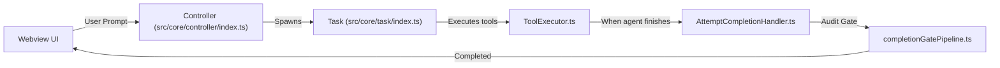
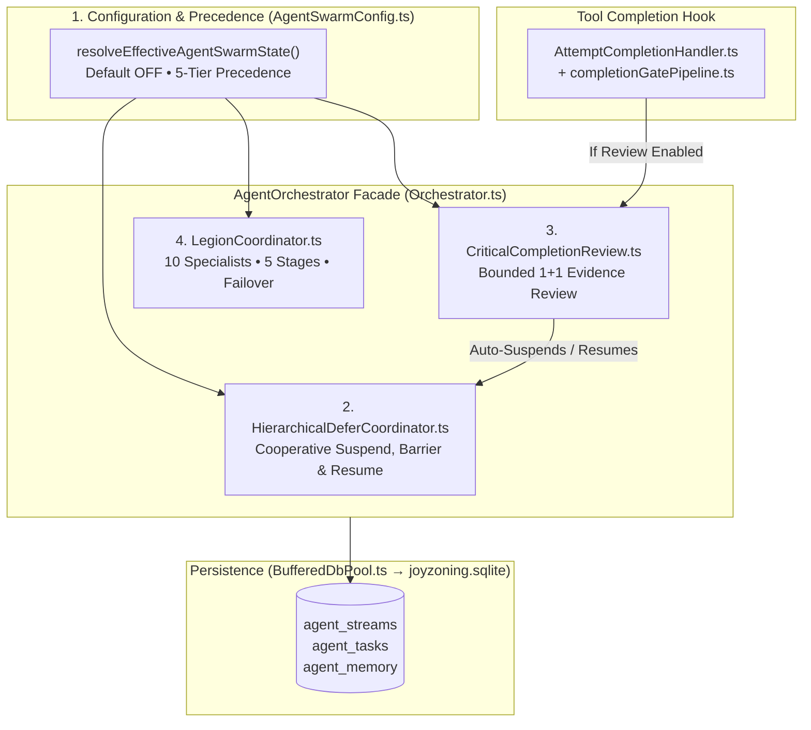

# 01 — The System from Scratch (Zero Prior Knowledge)

This guide explains the entire Agent Swarm & Legion architecture assuming you have **never seen the LUMI repository before**.

---

## 1. What is LUMI, and where does Agent Swarm live?

LUMI (packaged under the internal codename `dietcode` in protobufs and `lumi` in VS Code settings) is a **VS Code extension** that embeds an autonomous coding agent. It consists of two runtime processes:

1. **The Extension Host (Node.js / TypeScript in `src/`):**
   - Owns file I/O, terminal execution, LLM provider streams, configuration state (`StateManager`), the multi-agent orchestrator (`AgentOrchestrator`), and the local SQLite database (`joyzoning.sqlite` via `BufferedDbPool`).
2. **The Webview UI (React / Vite in `webview-ui/`):**
   - Renders the chat interface and the Settings view inside a VS Code webview panel. Communicates with the Extension Host over gRPC-style protobuf messages (`proto/dietcode/state.proto`) and `ExtensionState` snapshots (`src/shared/ExtensionMessage.ts`).

### How a normal (single-agent) task runs in LUMI

When a user types a prompt in LUMI with all Agent Swarm features **off** (the default):

When the LLM decides it is finished, it invokes the `attempt_completion` tool (`AttemptCompletionHandler.ts`). That handler runs `runCompletionGateFlow` (`src/core/task/tools/completionGatePipeline.ts`), which verifies that the agent didn't leave broken build/audit state behind.

---

## 2. What was already in LUMI before Agent Swarm?

Before the `agentswarm` specs (`agentswarm.md` through `agentswarm4.md`) were introduced, LUMI already had two foundational building blocks:

### A. `AgentOrchestrator` (`src/infrastructure/ai/Orchestrator.ts`)
An in-process coordinator that tracks **streams** (`agent_streams` table), **tasks** (`agent_tasks` table), and **per-stream key-value memory** (`agent_memory` table):
- A **stream** (`id`, `parentId`, `status: 'active' | 'paused' | 'completed' | 'failed'`, `createdAt`) represents one independent agent execution context.
- A parent stream can spawn child streams (`parentId = parentStreamId`).
- Each stream has a durable key-value store in `agent_memory` (`streamId`, `key`, `value`, `updatedAt`) where JSON documents (checkpoints, handoffs, roadmaps, file reservations) are stored.

### B. `BufferedDbPool` (`src/infrastructure/db/BufferedDbPool.ts`)
Instead of blocking the Node.js event loop with synchronous SQLite disk writes on every agent thought or tool call, `BufferedDbPool` sits between `AgentOrchestrator` and `better-sqlite3`:
- **Active Buffer (`this.activeBuffer`):** Direct writes (`dbPool.push(op)` or `dbPool.pushBatch(ops)` with **no** `agentId`) go into `this.activeBuffer` and are flushed to SQLite inside a single `BEGIN IMMEDIATE ... COMMIT` transaction every **1,000 ms** (or immediately when `await dbPool.flush()` is called).
- **Shadow Overlays (`this.agentShadows`):** When a write is called with an `agentId` (`dbPool.push(op, streamId)`), it does **not** go to `this.activeBuffer` or disk. It sits in a private in-memory overlay (`this.agentShadows.get(streamId)`) until `dbPool.commitWork(streamId)` drains that overlay into `this.activeBuffer`, or `dbPool.rollbackWork(streamId)` discards it.

> [!IMPORTANT]
> **Why you must know about Shadow Overlays right now:**
> Over half of the critical bugs discovered during implementation ([PM-001](../postmortems/PM-001-shadow-buffer-foreign-key-failure.md), [PM-011](../postmortems/PM-011-completion-state-stranded-in-shadow-overlay.md)) happened because someone wrote to a shadow overlay when they meant to write to `this.activeBuffer`, or wrote to a shadow overlay *after* calling `commitWork(streamId)`. See [ADR-0010](../adr/ADR-0010-direct-writes-for-shared-rows.md).

---

## 3. What are the 3 Agent Swarm Engines?

The four original specification documents in `/Users/bozoegg/Downloads/LUMI/agentswarm/` (`agentswarm.md`, `agentswarm2.md`, `agentswarm3.md`, `agentswarm4.md`) plus the Legion extension define **three auxiliary orchestration capabilities** that plug into `AgentOrchestrator` and `AttemptCompletionHandler`:

### Capability 1: Hierarchical Defer & Resume (`HierarchicalDeferCoordinator.ts`)
- **Problem it solves:** When a parent agent has spawned child/grandchild streams and needs to pause the hierarchy (for example, while a completion review inspects the workspace, or because a user/coordinator requested a pause), **aborting** in-flight children destroys their context and forces blind task replay.
- **How it works:**
  1. **Defer ≠ Cancel:** Deferring transitions a stream or multi-stream hierarchy into `"suspending"` → `"waiting_for_children"` → `"suspended"` while preserving `agent_tasks` as `"pending"` with `"deferred": true` metadata.
  2. **Parent Gate (`acceptingNewWork = false`):** Immediately stops the parent stream from dispatching new work (`dispatchTask`, `spawnSubAgent`, `delegateWork`) until resumed.
  3. **Control Inbox & Safe Boundaries:** Sends idempotent `suspend` control messages (`stream_control_inbox` in `agent_memory`) to every descendant across all hierarchy depths (parent → child → grandchild). Children pause at their next cooperative boundary (`turn_complete`, `tool_completed`, or `safe_checkpoint`), save a `StreamExecutionCheckpoint` (`stream_execution_checkpoint`), and acknowledge suspension.
  4. **Multi-Level Suspension Barrier:** Tracks every descendant (`pendingAckStreamIds`). Only when `pendingAckStreamIds.length === 0` does the pipeline transition from `"waiting_for_children"` to `"suspended"`. If a child crashes (`failStream`) or finishes (`completeStream`) while the barrier is waiting, `reconcileAfterStreamFailure` automatically satisfies that child's slot so the barrier **never deadlocks** ([PM-006](../postmortems/PM-006-multi-level-barrier-deadlock.md)).
  5. **Idempotent Resume:** `resumeHierarchy` restores each stream from its checkpoint and uses `stream_step_receipts` to guarantee completed steps are **never re-executed**.

### Capability 2: Critical Completion Review (`CriticalCompletionReview.ts`)
- **Problem it solves:** Agents sometimes call `attempt_completion` prematurely — with unverified claims, missing requirements, or subtle regressions. On the other hand, open-ended "critic loops" can argue forever without converging.
- **How it works:**
  1. **Wired into `attempt_completion`:** When `agentSwarmCriticalReviewEnabled` is true (or `manualInvocation` is passed), `AttemptCompletionHandler` calls `evaluateOptionalCriticalCompletionReview` (`completionGatePipeline.ts`) right after the standard audit gate passes.
  2. **Auto-Defer around Review:** If the stream is part of an active hierarchy and `hierarchicalDeferEnabled` is on, `runReview` automatically suspends the hierarchy before evaluating findings and **always** resumes the hierarchy in a `finally` block once the review finishes ([PM-007](../postmortems/PM-007-review-left-pipeline-suspended-and-unwired.md)).
  3. **Strict Finding Classification:** Every finding is classified into one of two categories:
     - `verified_defect`: Backed by concrete `evidenceRefs` (failing test, file/line mismatch, broken requirement) or `blocking === true`.
     - `unverified_concern`: Speculative risk or question lacking concrete evidence.
  4. **Decisive 4-Way Resolution:** Every review cycle must end in exactly one decision:
     - `ACCEPT`: Zero verified defects and zero unverified concerns. Completion proceeds.
     - `ACCEPT_WITH_NOTE`: Zero verified defects, one or more unverified concerns. Completion proceeds, with concerns explicitly separated in the final report.
     - `REMEDIATE`: Verified defects exist and the remediation budget (`maxRemediationPasses`, default `1`) is not exhausted. `AttemptCompletionHandler` **blocks completion**, queues structured corrective tasks (`dispatchTask` with ` bypassSuspensionCheck: true`), and tells the agent to fix them.
     - `ESCALATE`: Verified defects persist after the remediation budget is exhausted (`1` initial review + `1` follow-up pass after `1` remediation pass = **1+1 bound**). Completion is blocked and escalated to the user/coordinator.

### Capability 3: The Legion (`LegionCoordinator.ts`)
- **Problem it solves:** Complex engineering tasks span architecture, implementation, security, testing, UX, and documentation. A single generalist prompt struggles to maintain specialist rigor across all of them simultaneously.
- **How it works:**
  1. **10 Built-In Specialist Roles across 5 Dependency Stages:**
     - **Stage 1 (`discovery_architecture`):** `legion_systems_architect`, `legion_codebase_researcher`
     - **Stage 2 (`implementation`):** `legion_implementation_engineer`, `legion_data_migration_specialist`, `legion_ux_ergonomics` (also accepts legacy alias `legion_Trends_ux`)
     - **Stage 3 (`hardening_security`):** `legion_resilience_hardener`, `legion_security_auditor`
     - **Stage 4 (`verification_qa`):** `legion_verification_qa`, `legion_performance_profiler`
     - **Stage 5 (`synthesis_docs`):** `legion_documentation_synthesizer`
  2. **Deterministic Multi-Signal Classification (`classifyTask`):** Scores the objective, target files, and constraints against each specialist's keyword weights, file-pattern regexes, and complexity floor. Produces a `LegionClassificationResult` with confidence scores, explicit selection reasons, and a stage execution plan capped at `maxConcurrency` (default `4`, hard max `8`).
  3. **Formation & File Reservation (`formLegion`):** Spawns child streams and tasks for each selected specialist, checks for active file reservation conflicts (`file_res:<path>`), and dispatches Stage 1 (`discovery_architecture`).
  4. **Stage-Gated Handoff & Automatic Lifecycle (`settleSpecialistStream`):** When `Orchestrator.completeStream(streamId, summary)` is called on a specialist stream, `LegionCoordinator` records its handoff artifact and, once all members in the current stage are settled, automatically promotes the next stage (`queued` → `active`) with upstream context summaries injected into their task payloads.
  5. **Bounded Failover (`reconcileSpecialistStreamLifecycle`):** When `Orchestrator.failStream(streamId, reason)` is called on a specialist stream, `LegionCoordinator` marks the slot `"rerouted"` and spawns a fallback specialist (up to `LEGION_MAX_ATTEMPTS_PER_SLOT = 2`). If the fallback also fails, the slot is permanently marked `"failed"` (terminal states `completed`, `failed`, and `rerouted` can never be overwritten — [PM-009](../postmortems/PM-009-terminal-state-flip-and-unwired-lifecycle.md)).

---

## 4. The Golden Rule of Agent Swarm: Zero Overhead When Off

Every entry point checks `resolveEffectiveAgentSwarmState` (`src/infrastructure/ai/AgentSwarmConfig.ts`). When all flags are at their default (`false`):
- `AttemptCompletionHandler` does not instantiate or run `CriticalCompletionReviewService`.
- `Orchestrator.completeStream` and `failStream` perform fast memory look-ups that no-op when no active pipeline or formation exists.
- The single-agent path behaves identically to a build without `agentswarm`.

Next: Read **[02 — Line-by-Line Codebase Tour](02-codebase-tour.md)** to see how every file is structured and where each invariant lives.

